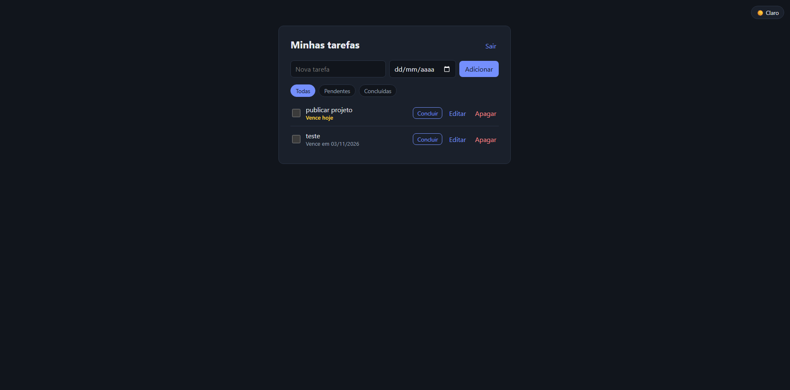
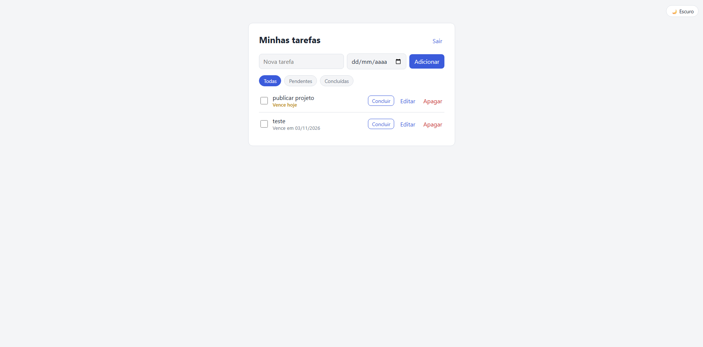
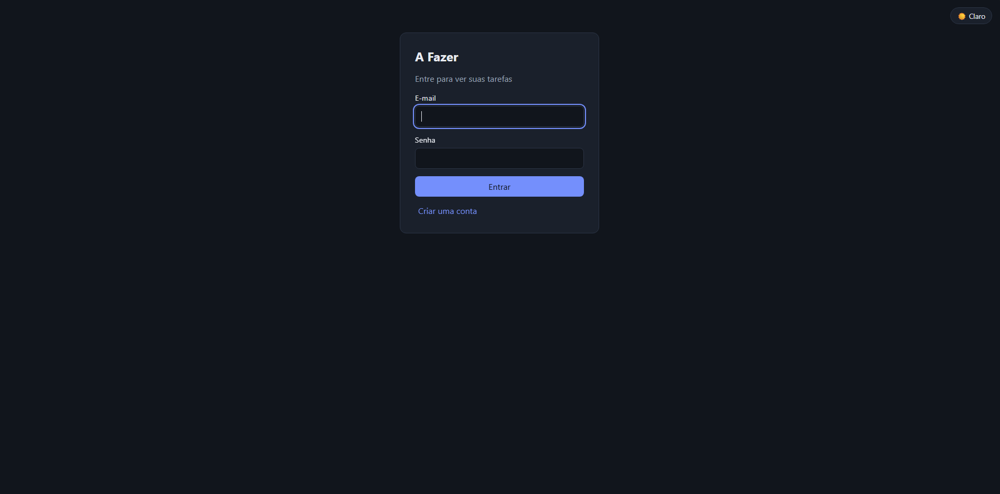
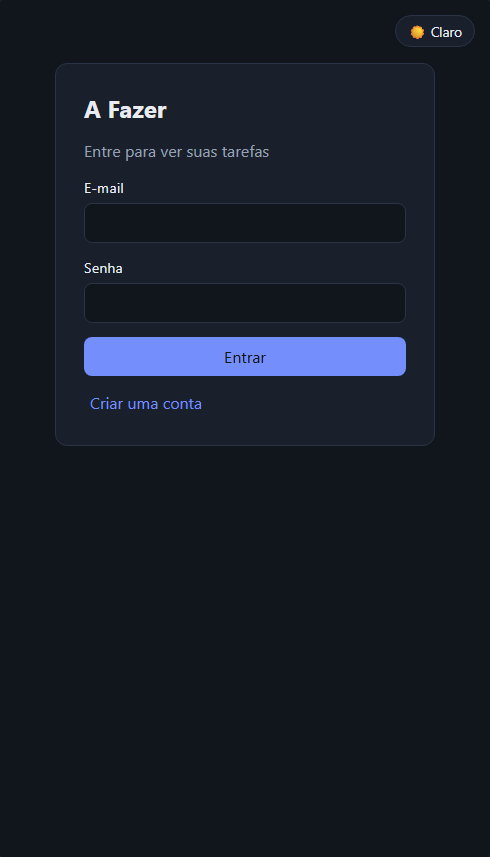

# A Fazer

Aplicação web de lista de tarefas com **cadastro e login de usuários**: cada pessoa vê e gerencia apenas as próprias tarefas. O back-end é uma API REST em **C# / ASP.NET Core** e o front-end é feito em **React**.

Projeto de portfólio, criado para praticar autenticação com JWT, acesso a dados com Entity Framework Core, testes de integração e uma interface responsiva com modo claro e escuro.

## Screenshots

| Tema escuro | Tema claro |
|---|---|
|  |  |

| Login | Mobile |
|---|---|
|  |  |

## Funcionalidades

**Interface**
- Cadastro e login
- Criar, editar, concluir e apagar tarefas, com data de vencimento opcional
- Filtro por **Todas**, **Pendentes** e **Concluídas**
- Destaque visual: **amarelo** para tarefas que vencem hoje e **vermelho** para as atrasadas
- Modo claro e escuro (segue o sistema na primeira visita e lembra a escolha)
- Layout responsivo para celular
- Sessão expirada ou token inválido leva de volta ao login

**API**
- Autenticação com **JWT Bearer**; senhas guardadas com hash (`PasswordHasher`)
- Isolamento por usuário: uma tarefa de outra pessoa responde `404`
- Validação de entrada, com respostas `400` padronizadas
- Migrations aplicadas automaticamente ao iniciar
- Documentação interativa com **Swagger** (botão *Authorize* para testar com o token)

## Tecnologias

| Camada | Tecnologias |
|---|---|
| Back-end | C#, ASP.NET Core (.NET 10), Minimal APIs |
| Dados | Entity Framework Core, SQLite, migrations |
| Autenticação | JWT Bearer, ASP.NET Core Identity `PasswordHasher` |
| Documentação | Swagger / OpenAPI (Swashbuckle) |
| Testes | xUnit, `WebApplicationFactory` (testes de integração) |
| Front-end | React 19, Vite, JavaScript, CSS puro |

## Pré-requisitos

- [.NET SDK 10](https://dotnet.microsoft.com/download)
- [Node.js](https://nodejs.org/) (versão LTS)

## Como executar

São dois processos: a API e a interface. Use dois terminais.

**1. API**

```bash
dotnet run --project src/TodoApi
```

O terminal mostra o endereço (por padrão `http://localhost:5196`). Em desenvolvimento a chave JWT vem de `appsettings.Development.json`, e o banco SQLite (`todos.db`) é criado sozinho. A raiz da API redireciona para o Swagger.

**2. Interface**

```bash
cd web
npm install
npm run dev
```

Abra `http://localhost:5173` e crie uma conta. Em desenvolvimento, o Vite encaminha as chamadas `/api` para a API, então não é preciso configurar CORS. Se a API estiver em outra porta, defina `VITE_API_URL`:

```bash
VITE_API_URL=http://localhost:5000 npm run dev
```

### Testando só a API pelo Swagger

1. Abra `/swagger` e use `POST /api/auth/register` com e-mail e senha (mínimo de 8 caracteres).
2. Copie o `token` da resposta.
3. Clique em **Authorize**, cole o token e chame os endpoints de `/api/todos`.

### Fora do ambiente de desenvolvimento

Fora do ambiente de desenvolvimento a API **não inicia sem a variável de ambiente `Jwt__Key`** (mínimo 32 caracteres), de propósito, para nunca rodar com uma chave fraca.

## Testes

```bash
dotnet test
```

Os testes de integração sobem a API de verdade, com um banco SQLite temporário por execução, e cobrem:
- cadastro (inclusive e-mail duplicado, e-mail inválido e senha curta) e login;
- CRUD de tarefas e filtro por status;
- acesso sem token (`401`);
- isolamento entre usuários: um usuário não consegue ver, alterar nem apagar a tarefa de outro.

## Endpoints

| Método | Rota | Auth | Descrição |
|---|---|---|---|
| POST | `/api/auth/register` | não | Cria o usuário e devolve o token |
| POST | `/api/auth/login` | não | Devolve o token |
| GET | `/api/todos` | sim | Lista as tarefas (`?completed=true` ou `false`) |
| GET | `/api/todos/{id}` | sim | Busca uma tarefa |
| POST | `/api/todos` | sim | Cria uma tarefa |
| PUT | `/api/todos/{id}` | sim | Atualiza uma tarefa |
| DELETE | `/api/todos/{id}` | sim | Remove uma tarefa |

## Decisões técnicas

- **Minimal APIs com DTOs:** a entidade do banco nunca é exposta direto. Entrada e saída têm contratos próprios (`Dtos/`).
- **`404` em vez de `403`** ao acessar a tarefa de outra pessoa, para não revelar que ela existe.
- **Mesma resposta no login** para e-mail inexistente e senha errada, para não permitir descobrir quais e-mails estão cadastrados.
- **Chave JWT lida por `IOptions`:** o `TokenService` (que emite) e a validação (que verifica) leem a mesma configuração, então nunca divergem.
- **SQLite:** não exige servidor de banco, o que deixa o projeto fácil de clonar e rodar. A string de conexão fica na configuração, e o EF Core permite trocar de banco com poucas mudanças.
- **Token no `localStorage`:** escolha simples para o escopo do projeto. Um cenário de produção exigiria avaliar cookies `HttpOnly` por causa de XSS.

## Estrutura

```
src/TodoApi/
  Auth/         emissão do token JWT e configurações
  Models/       entidades (User, TodoItem)
  Dtos/         contratos de entrada e saída
  Data/         DbContext
  Migrations/   migrations do EF Core
  Endpoints/    rotas da API
tests/TodoApi.Tests/    testes de integração
web/                    interface em React (Vite)
docs/screenshots/       imagens usadas neste README
```

## Migrations

```bash
dotnet tool restore
dotnet tool run dotnet-ef migrations add NomeDaMigration --project src/TodoApi
```

## Próximos passos

- [ ] Paginação e ordenação na listagem
- [ ] Testes do front-end (Vitest + Testing Library)
- [ ] GitHub Actions rodando os testes a cada push
- [ ] Campo de descrição na interface (a API já suporta)
